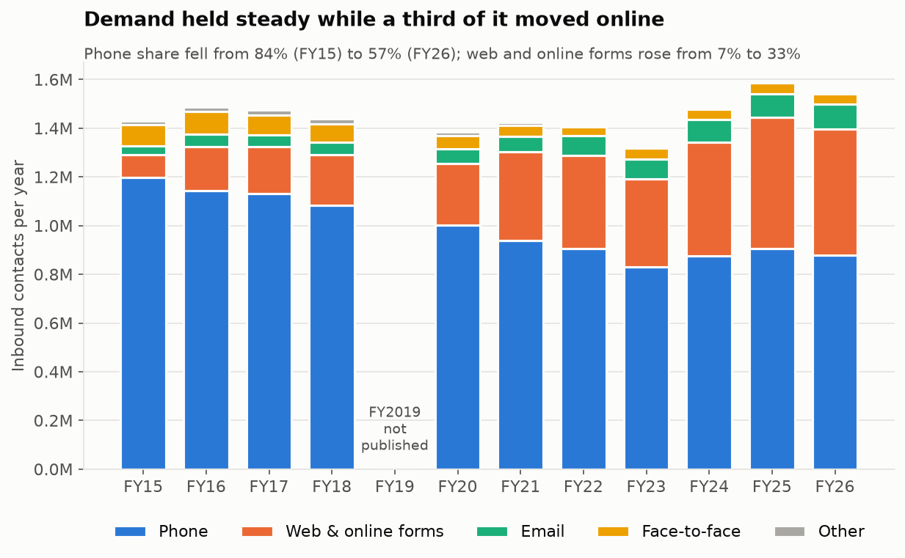
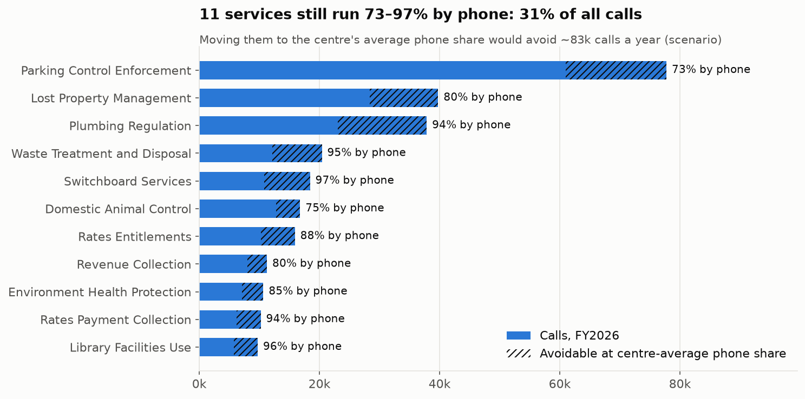
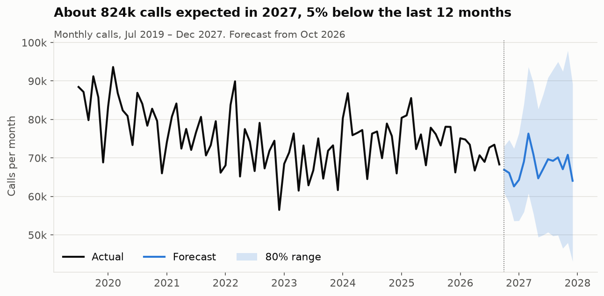
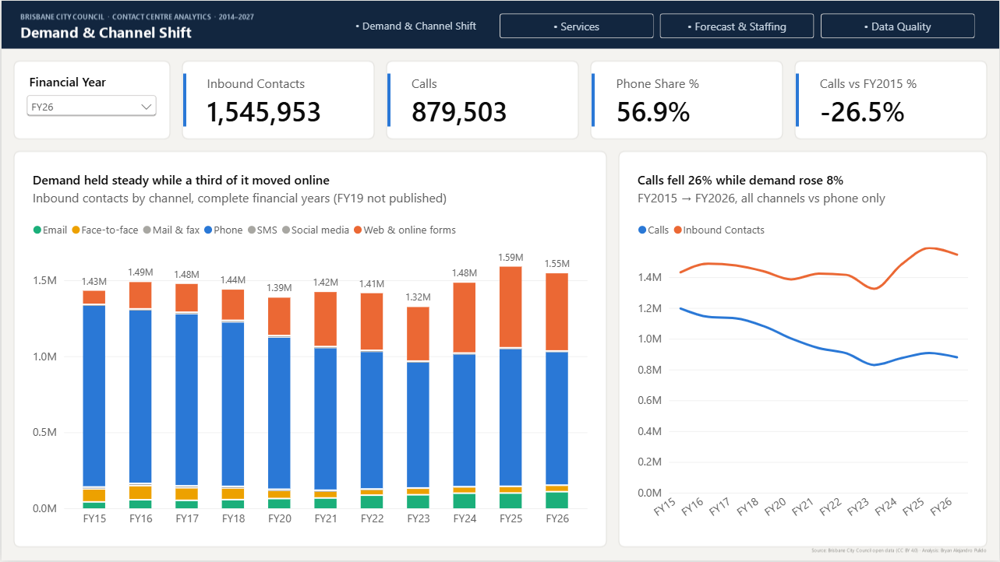
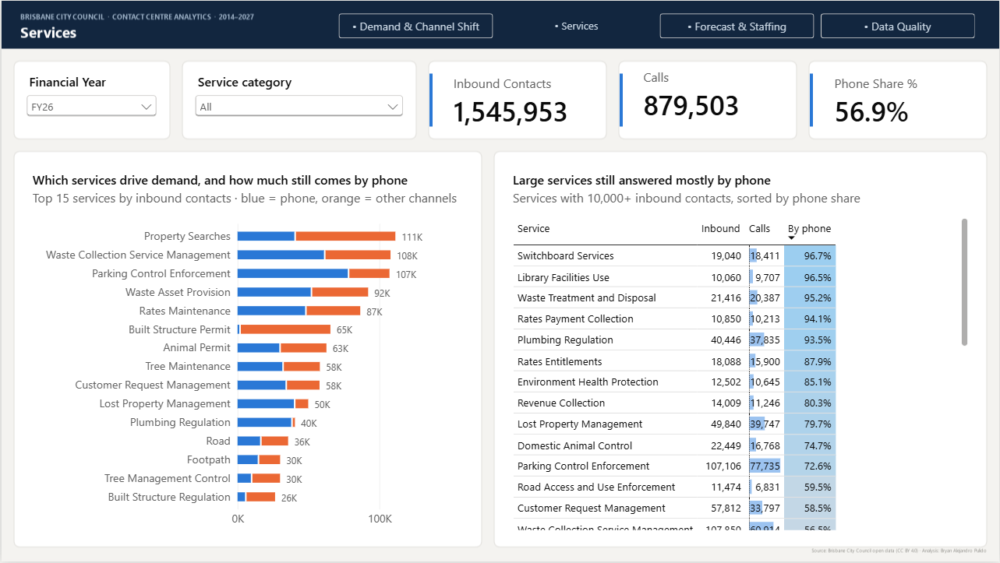
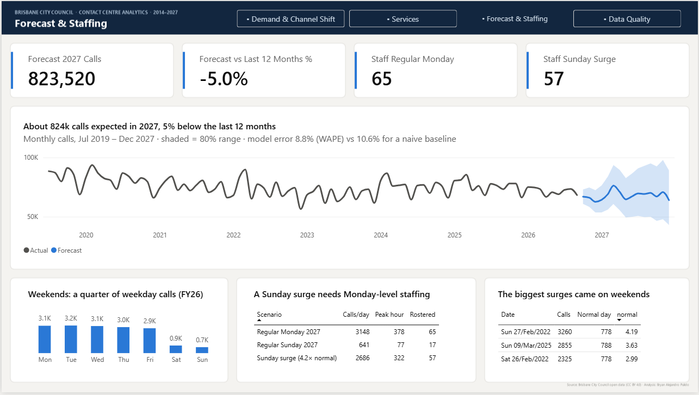
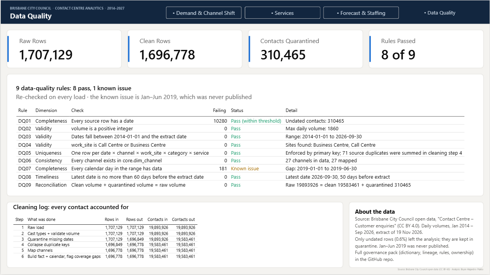

# Brisbane City Council Contact Centre — Demand, Channel Shift & 2027 Staffing Forecast

**Demand on Brisbane City Council's Contact Centre has grown, yet it answers 317,000 fewer calls a year than in 2015. Where did the work go, which services are still stuck on the phone, and how many agents will 2027 need?**

An end-to-end analysis of 12 years of real Council open data (19.9 million customer contacts, 2014–2026): **PostgreSQL** for loading, cleaning and a full data-governance layer; **SQL** for nine business questions; **Python** for a validated daily call forecast and an Erlang C staffing scenario; and a four-page **Power BI** dashboard that reads from the same governed data.



---

## The Business Problem

Council contact centres are under pressure to do more with less: residents expect to report a pothole or book a bin service online, but the phone line still has to be staffed for storms, floods and peak season. Workforce planners need to know three things — how demand is shifting between channels, which services keep generating calls, and how many people to roster.

**The business question:** how has demand on Brisbane City Council's Contact Centre changed between 2014 and 2026 — the move from phone to digital channels, seasonal and weekly peaks, and the services that drive contacts — and how many calls, and phone agents, should the Council plan for in 2027?

## My Approach

1. **Governed data pipeline in PostgreSQL.** Loaded the full open-data extract (1,707,129 rows) into a raw staging layer, then cleaned it in six logged steps (`sql/01`). Every step records rows and contacts in and out, and undated rows are quarantined rather than deleted.
2. **Data-governance layer.** Nine data-quality rules (completeness, validity, uniqueness, consistency, timeliness, reconciliation) re-run on every load, a data dictionary, lineage and a proposed ownership model — documented in **[data_governance.md](data_governance.md)**.
3. **Nine business questions answered in SQL** (`sql/03`) — channel mix, service drivers, Pareto concentration, phone-dependent services, weekly and seasonal patterns, and surge days — using CTEs, window functions (`LAG`, `FIRST_VALUE`, cumulative `SUM() OVER`) and `PERCENTILE_CONT`.
4. **Validated forecast.** A regression model with ARIMA errors (weekday, Queensland public holidays, Christmas shutdown, annual seasonality) predicts daily calls, tested on 12 months it never saw against a seasonal-naive baseline.
5. **Staffing scenario.** Erlang C converts the forecast into peak-hour agents and rostered staff, under clearly stated assumptions.
6. **Power BI dashboard** built on a dedicated semantic layer (`sql/04`), with every measure reconciled to the SQL results before any page was built.

## Key Findings

| Question | Finding |
|---|---|
| Is demand growing? | Inbound contacts rose **8%**, from 1.43M (FY2015) to 1.55M (FY2026) |
| Where did it go? | Phone share fell from **83.6% to 56.9%**; web and online forms rose from **6.6% to 33.4%**; counters fell from 6.0% to 2.7% |
| How much phone work disappeared? | **317,166 fewer calls a year (−26.5%)**; an average weekday dropped from 4,188 to 3,059 calls |
| What drives demand? | Property searches (111K, +140% since FY2016), bin-service management (108K, +150%) and parking enforcement (107K, +54%) lead FY2026 |
| How concentrated are calls? | **10 of 321 services generate half of all calls**; 37 generate 80% |
| What hasn't shifted online? | **11 large services still arrive 73–97% by phone** — 268,594 calls, 31% of the total |
| When do calls arrive? | Weekdays carry ~3,000 calls a day; Saturdays 874 and Sundays 683. March is the busiest month (index 109), December the quietest (86) |
| What do surges look like? | The two biggest surges were **weekend weather events**: the Brisbane floods (Sun 27 Feb 2022, **4.2×** a normal Sunday) and ex-Tropical Cyclone Alfred (Sun 9 Mar 2025, **3.6×**) |
| Proactive contact | Council-initiated contacts (mostly SMS) grew from 1,202 to **380,557 a year** |



## Forecast: 2027

The model was trained to September 2025 and tested on the following 12 months:

| Model | Daily error (WAPE) | Error on the yearly total |
|---|---|---|
| Seasonal naive (same weekday last year) | 10.6% | +5.2% |
| **Regression + ARIMA errors** | **8.8%** | **+0.8%** |

Refitted on all data, it expects **about 824,000 calls in 2027** (80% range 639,000 – 1,053,000) — **5% below the last 12 months**, continuing a gentle decline. March is the busiest month.



**Staffing scenario (Erlang C, peak hour).** Assumptions: 12% of daily calls in the peak hour, 6-minute average handle time, 80% of calls answered within 60 seconds, 35% shrinkage.

| Scenario | Calls that day | Agents on phones | Rostered staff |
|---|---|---|---|
| Regular Monday 2027 | 3,148 | 42 | 65 |
| Regular Sunday 2027 | 641 | 11 | 17 |
| Sunday surge (4.2× normal) | 2,686 | 37 | 57 |

A storm Sunday needs **more than three times** the usual Sunday roster — close to a normal Monday.

## Why This Matters

The headline "calls are down" hides two different stories. Channel shift has worked: web forms absorbed all of the growth in demand, and the centre now handles a quarter fewer calls than a decade ago. But the remaining phone load is concentrated in a short list of services that never moved online, and the centre's biggest risk is not the average day — it is the weekend storm, when volume quadruples on the day the roster is thinnest.

## Business Recommendations

1. **Target the 11 phone-dependent services for digital redesign.** If they reached the centre's average phone share (57%), about **83,000 calls a year (9.5%)** would be avoided. Switchboard, library bookings, rates and plumbing enquiries are the clearest candidates.
2. **Build a weekend surge plan.** Severe-weather events quadruple weekend calls. An on-call pool, triggered by Bureau of Meteorology warnings, would cover the gap between a 17-person Sunday roster and the ~57 people a surge needs.
3. **Plan 2027 capacity on ~824,000 calls, with headroom for March.** Use the 80% range for budgeting and refresh the forecast quarterly as new data is published.
4. **Measure the proactive channel.** SMS and email notifications now reach 380,000 contacts a year; tracking whether they prevent follow-up calls would show their real value.

## Interactive Dashboard (Power BI)

`bcc_contact_centre_dashboard.pbix` — four pages built on the `bi` semantic layer, with a page navigator. Every measure was reconciled to the SQL results before any page was designed.

| Demand & Channel Shift | Services |
|---|---|
|  |  |
| **Forecast & Staffing** | **Data Quality** |
|  |  |

## Data Governance

Undated rows (0.6% of rows, 310,465 contacts) are quarantined rather than deleted, and January–June 2019 — never published — is flagged as a known gap instead of being filled with invented values. A reconciliation rule proves that clean plus quarantined contacts equal the raw total, to the contact. Full detail, including how each piece maps to Microsoft Purview and Fabric: **[data_governance.md](data_governance.md)**.

## Limitations

- The dataset contains **volumes only** — no handle times, wait times or interval data — so the staffing figures are a scenario under stated assumptions, not an operational roster. With the Council's telephony data the same model becomes operational.
- January–June 2019 was never published; FY2019 is excluded from year-on-year comparisons and the forecast trains only on data from July 2019.
- The "calls avoided" figure is a what-if scenario, not a forecast of what digital redesign would achieve.
- Surge days are matched to weather events by date; the dataset does not record the cause of a call.

Full methodology, all nine queries' results and the forecast validation: **[executive_summary.md](executive_summary.md)**.

## Tools & Skills

`PostgreSQL` (staging → clean → semantic layer, transactions, primary keys) · `SQL` (CTEs, window functions, `PERCENTILE_CONT`, Pareto analysis) · **data governance** (quality rules with history, lineage, data dictionary, RACI, quarantine and reconciliation) · `Python` (pandas, statsmodels SARIMAX, Monte Carlo simulation, matplotlib) · **time-series forecasting** with out-of-sample validation against a baseline · **Erlang C** workforce modelling · `Power BI` (DAX measures, semantic model, custom design, page navigation) · business storytelling for a non-technical audience.

## Repository Structure

```
bcc-contact-centre-analytics/
├── README.md
├── executive_summary.md
├── data_governance.md
├── bcc_contact_centre_analysis.ipynb   # runs sql/03, charts, forecast, Erlang C
├── bcc_contact_centre_dashboard.pbix
├── sql/
│   ├── 00_staging.sql                  # raw load, all columns as text
│   ├── 01_clean_model.sql              # 6 logged cleaning steps + star schema
│   ├── 02_data_quality.sql             # 9 data-quality rules with history
│   ├── 03_business_analysis.sql        # 9 business questions
│   └── 04_powerbi_views.sql            # semantic layer for Power BI
└── images/
```

## Reproduction

The raw extract (~145 MB) is not committed. Download the full CSV from [Brisbane City Council open data — Contact Centre – Customer enquiries](https://data.brisbane.qld.gov.au/explore/dataset/contact-centre-customer-enquiries) (CC BY 4.0).

1. Create a PostgreSQL database `bcc_contact_centre` (built with PostgreSQL 17).
2. Run `sql/00_staging.sql` with `psql -v csv="<path to CSV>"`, then `sql/01`, `sql/02` and `sql/03`.
3. Execute `bcc_contact_centre_analysis.ipynb` (pandas, statsmodels, SQLAlchemy, psycopg2, `holidays`). It writes the forecast and staffing tables back to PostgreSQL.
4. Run `sql/04_powerbi_views.sql`, then open the `.pbix` and refresh against your local database.

---

*Independent portfolio project by Bryan Alejandro Pulido. Data: Brisbane City Council, "Contact Centre – Customer enquiries", licensed under [CC BY 4.0](https://creativecommons.org/licenses/by/4.0/).*
