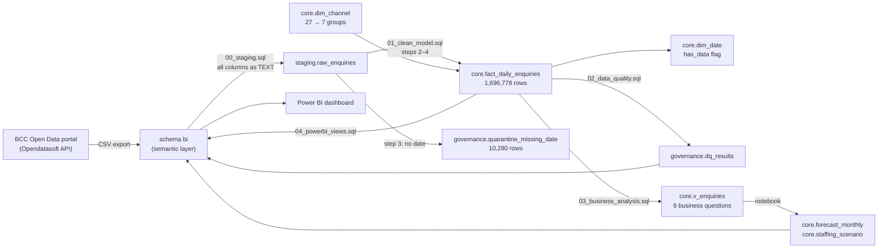

# Data Governance Pack — BCC Contact Centre Analytics

How the data in this project is defined, checked, traced and owned. The aim is that anyone picking up the analysis can answer four questions without asking the author: *What does this column mean? Can I trust it? Where did it come from? Who do I ask?*

---

## 1. Source

| Item | Value |
|---|---|
| Dataset | Contact Centre – Customer enquiries |
| Publisher | Brisbane City Council (BCC) |
| Link | https://data.brisbane.qld.gov.au/explore/dataset/contact-centre-customer-enquiries |
| Licence | Creative Commons Attribution 4.0 (CC BY 4.0) |
| Grain | Daily contact volume by channel, work site, category and service |
| Coverage | 2014-01-01 to 2026-09-30 |
| Extract used | Full CSV export, downloaded 2026-11-19 (1,707,129 rows, 19,893,926 contacts) |
| Personal information | None — aggregated counts only, no customer or staff identifiers |

---

## 2. Data lineage

Run order: `00` → `01` → `02` → `03` → notebook → `04`. Power BI reads only the `bi` schema, so the dashboard shows the same numbers as the SQL analysis and the notebook.

Every step is a script in `sql/`, so the whole chain can be re-run from the raw file. Row and contact counts at each step are stored in `governance.cleaning_log`:

| Step | Rule | Rows in | Rows out | Contacts removed |
|---|---|---:|---:|---:|
| 1 | Raw load, all columns as text | 1,707,129 | 1,707,129 | 0 |
| 2 | Cast date → DATE, volume → INT; keep positive integer volumes | 1,707,129 | 1,707,129 | 0 |
| 3 | Quarantine rows with no date (kept for audit, not deleted) | 1,707,129 | 1,696,849 | 310,465 |
| 4 | Sum 71 duplicate keys into one row each | 1,696,849 | 1,696,778 | 0 |
| 5 | Map 27 channels to 7 groups + Inbound/Outbound; fail on any unmapped label | 1,696,778 | 1,696,778 | 0 |
| 6 | Build fact table (primary key on the daily grain) + calendar with coverage flag | 1,696,778 | 1,696,778 | 0 |

---

## 3. Data dictionary

### `core.fact_daily_enquiries` — one row per day × channel × site × category × service

| Column | Type | Meaning | Example | Notes |
|---|---|---|---|---|
| `enquiry_date` | DATE | Day the contacts were received or sent | 2026-09-30 | Never null (undated rows quarantined) |
| `channel` | TEXT | Raw contact channel as published | Voice In | 27 values, all mapped in `dim_channel` |
| `work_site` | TEXT | Where the contact was handled | Call Centre | Call Centre or Business Centre |
| `category` | TEXT | Council service area | Road Network Management | 127 values |
| `service` | TEXT | Specific service within the category | Road | 355 values (374 category + service pairs); the same service name can sit under more than one category, so a service is identified by **category + service** |
| `volume` | INT | Number of contacts | 8 | Always > 0 |

### `core.dim_channel` — business rule for channels

| Column | Meaning |
|---|---|
| `channel` | Raw channel label (primary key) |
| `channel_group` | Phone · Web & online forms · Social media · Email · Face-to-face · Mail & fax · SMS |
| `direction` | **Inbound** = customer-initiated (demand). **Outbound** = Council-initiated (Voice Out, e-mail Out, Mail Out, SMS Out) |
| `note` | Clarification where the label is ambiguous |

Demand analysis and forecasting use **Inbound** only; outbound contacts are workload, not demand.

### `core.dim_date` — calendar

| Column | Meaning |
|---|---|
| `calendar_date` | Every day from 2014-01-01 to 2026-09-30 |
| `year`, `month`, `weekday`, `iso_weekday`, `is_weekend` | Calendar attributes |
| `financial_year` | Australian financial year (1 July – 30 June), labelled by the year it ends: July 2025 → FY2026 |
| `has_data` | FALSE for days with no records at all (the 181 days from 2019-01-01 to 2019-06-30) |

### Business glossary

| Term | Definition used in this project |
|---|---|
| Contact | One customer interaction or Council-initiated message, in any channel |
| Demand | Inbound contacts only |
| Channel shift | Change in the share of inbound demand handled by digital channels (web, app, email, social) versus phone and counter |
| Coverage gap | A period with no published records; treated as *unknown*, never as zero |

---

## 4. Data quality rules and latest results

Rules live in `governance.dq_rules`; each run of `sql/02_data_quality.sql` appends results to `governance.dq_results`. Latest run: extract of 2026-11-19.

| Rule | Dimension | Rule | Failing | Threshold | Status |
|---|---|---|---:|---:|---|
| DQ01 | Completeness | Every source row has a date | 10,280 rows (0.60%) | ≤ 1% | Pass (within threshold) |
| DQ02 | Validity | Volume is a positive integer | 0 | 0% | Pass |
| DQ03 | Validity | Dates between 2014-01-01 and the extract date | 0 | 0% | Pass |
| DQ04 | Validity | Work site is Call Centre or Business Centre | 0 | 0% | Pass |
| DQ05 | Uniqueness | One row per daily key | 0 | 0% | Pass |
| DQ06 | Consistency | Every channel is mapped | 0 (27 of 27 mapped) | 0% | Pass |
| DQ07 | Completeness | Every calendar day has data | 181 days (3.9%) | 0% | **Known issue** — Jan–Jun 2019 gap |
| DQ08 | Timeliness | Latest date ≤ 60 days before extract | 0 (50 days) | — | Pass |
| DQ09 | Reconciliation | Clean + quarantined contacts = raw contacts | 0 (19,583,461 + 310,465 = 19,893,926) | 0% | Pass |

**How known issues are handled**

- **Undated rows (DQ01):** 310,465 contacts (1.6% of all contacts) are excluded from time-based analysis. They stay in `governance.quarantine_missing_date`, and totals that ignore time can include them.
- **2019 gap (DQ07):** January–June 2019 is not filled or interpolated. Year-on-year comparisons skip 2019, and the forecast trains only on data after the gap.

---

## 5. Ownership (proposed RACI)

Roles are a proposal for how this data would be governed inside an organisation; they are not BCC's actual structure.

| Activity | Data owner (Customer Services manager) | Data steward (reporting analyst) | Data custodian (platform / IT) | Consumers (WFM, service leads) |
|---|---|---|---|---|
| Define what a contact and a channel mean | **A** | R | I | C |
| Maintain the channel mapping | A | **R** | I | C |
| Run quality rules and report results | I | **R** | C | I |
| Fix a failed Critical rule | A | R | **R** | I |
| Approve a new channel or site | **A** | R | I | I |
| Use the data for forecasts and dashboards | I | C | I | **R** |

R = responsible · A = accountable · C = consulted · I = informed

---

## 6. How this maps to enterprise tooling

This project runs on PostgreSQL, but each piece corresponds to a feature of Microsoft's governance stack:

| This project | Microsoft Purview / Fabric equivalent |
|---|---|
| Data dictionary (section 3) | Purview Data Catalog — asset and column descriptions |
| Business glossary | Purview business glossary terms linked to columns |
| Lineage diagram + `cleaning_log` | Purview lineage (captured automatically from Fabric pipelines) |
| `dq_rules` / `dq_results` | Purview Data Quality rules and scores |
| RACI | Owner and steward roles assigned on each data asset |
| `dim_channel`, `dim_date`, glossary terms | Fabric ontology: shared business definitions (Contact, Channel, Demand) that every report reuses |
| "No personal information" | Sensitivity labels (this dataset would be *Public*) |
